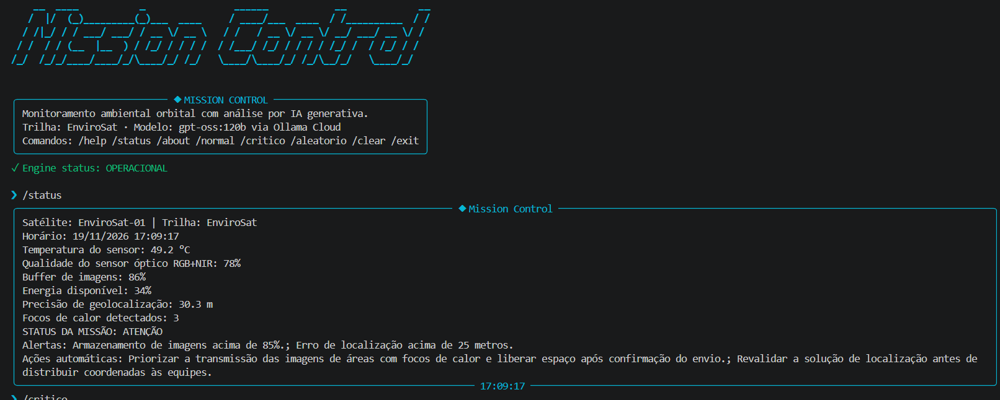
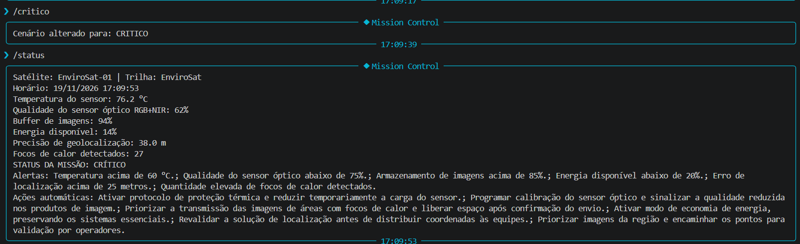

# 🚀 Mission Control AI — EnviroSat

## Integrantes
- Mariana Dreset CARBOLLAN — RM: 569207 — Turma: 1CCPJ
- Laura Godoy Callegari — RM: 569181 — Turma: 1CCPJ
- Modalidade: Dupla

## O que o projeto faz
O Mission Control AI — EnviroSat simula o monitoramento de um satélite de observação ambiental.
O sistema coleta telemetria, aplica regras de decisão em Python e utiliza o modelo `gpt-oss:120b`
via Ollama Cloud para explicar o estado da missão em linguagem natural.

## Persona atendida
A persona principal é o operador de um centro de controle ambiental. Ele precisa identificar
rapidamente falhas que possam comprometer imagens de focos de calor e informações usadas no
monitoramento de áreas protegidas. As análises também consideram as necessidades das brigadas
ambientais que recebem informações para validação em campo.

## Tecnologias utilizadas
- Python 3.10 ou superior
- Ollama Cloud API — `gpt-oss:120b`
- ollama, python-dotenv, Rich, prompt-toolkit e PyFiglet
- Servidor HTTP nativo do Python para a visualização local de demonstração

## Como executar
1. Instale Python 3.10 ou superior.
2. Clone ou baixe este repositório.
3. Crie e ative um ambiente virtual:
   - Windows: `python -m venv .venv` e `.venv\Scripts\activate`
   - macOS/Linux: `python -m venv .venv` e `source .venv/bin/activate`
4. Instale as dependências: `pip install -r requirements.txt`
5. Crie uma conta em https://ollama.com e gere uma API Key.
6. Copie `.env.example` para `.env` e coloque sua chave em `OLLAMA_API_KEY`.
7. Execute: `python main.py`

### Visualização local no navegador
Para a gravação e para os prints, execute `python web.py` e abra `http://127.0.0.1:8000`.
Essa tela local usa o mesmo `MissionEngine` da CLI: os cenários, alertas e a análise por IA não são simulados pela página.

**Segurança:** nunca envie o arquivo `.env` ao GitHub. Ele já está listado no `.gitignore`.

## Comandos da interface
- `/help` — lista comandos
- `/status` — mostra uma nova leitura da telemetria e o resultado das regras
- `/normal` — seleciona cenário normal
- `/critico` — seleciona cenário crítico
- `/aleatorio` — seleciona cenário aleatório
- `/about` — apresenta o projeto
- `/clear` — limpa o terminal
- `/exit` — encerra o programa

Depois de selecionar `/critico`, digite uma pergunta como `Analise a situação atual e explique o impacto para as brigadas ambientais.`

## Parâmetros monitorados e regras
| Parâmetro | Regra de alerta | Possível consequência |
|---|---|---|
| Temperatura do sensor | acima de 60 °C | perda de precisão do sensor térmico |
| Qualidade do sensor óptico RGB+NIR | abaixo de 75% | imagens menos confiáveis para análise ambiental |
| Buffer de imagens | igual ou acima de 85% | risco de não armazenar novas imagens |
| Energia | abaixo de 20% | interrupção de coleta/transmissão |
| Precisão de geolocalização | erro acima de 25 m | coordenadas imprecisas para equipes em terra |
| Focos de calor | 20 ou mais | maior demanda de triagem e validação |

## Proposta de valor / modelo de negócio
**Problema terrestre:** órgãos ambientais precisam identificar áreas prioritárias para verificar incêndios e possíveis mudanças na cobertura vegetal. Falhas no satélite podem atrasar a disponibilidade de imagens ou reduzir a confiança nas coordenadas.

**Quem paga:** o modelo proposto é híbrido. Órgãos públicos ambientais podem contratar o serviço para apoiar monitoramento territorial, enquanto concessionárias, seguradoras e empresas com compromissos ambientais podem contratar acesso a relatórios e dados especializados.

**Métrica de impacto:** como meta simulada de projeto, uma operação estável poderia apoiar a triagem diária de até 100 áreas prioritárias e disponibilizar alertas para equipes responsáveis pela validação. Esse número é uma meta hipotética para dimensionar a proposta, não um resultado real medido.

**Modelo de negócio:** serviço de dados (Data-as-a-Service) com assinatura institucional. O cliente recebe painéis, alertas e relatórios periódicos; a confirmação de ocorrências continua sendo feita pelos órgãos e equipes competentes.

## System Prompt
O prompt completo está em `prompts/system_prompt.md`. Ele orienta a IA a distinguir dados medidos de hipóteses, explicar o impacto terrestre e não afirmar que um foco de calor é um incêndio confirmado.

## Cenários de teste demonstráveis
1. **Operação normal:** execute `/normal`, depois `/status`. Os valores permanecem dentro das faixas definidas.
2. **Situação crítica:** execute `/critico`, depois `/status`. O sistema deve indicar temperatura alta, baixa qualidade óptica, buffer elevado, energia baixa, geolocalização imprecisa e muitos focos detectados.
3. **Análise com IA:** após `/critico`, pergunte: `Faça um diagnóstico da missão, priorize as ações e explique o impacto para as brigadas ambientais.`

## Verificação rápida
Execute `python -m unittest discover -s tests -v` para validar os cenários normal, crítico e o reaproveitamento da telemetria pela análise com IA.

## Limitações conhecidas
- Os dados são simulados e não vêm de um satélite real.
- A identificação de focos de calor não confirma incêndios; exige validação.
- O sistema não envia alertas para órgãos externos nem controla equipamentos reais.
- A análise depende da disponibilidade e da chave de acesso da Ollama Cloud.
- A métrica de 100 áreas prioritárias por dia é uma meta ilustrativa, não uma medição operacional.

## Demonstração
Vídeo em gravação: https://youtu.be/Iwj9e4kck58?is=r8g-pHWE6iH2jsG9

## Evidências

Os dois prints foram gerados pela visualização local do projeto. Para repetir a evidência, execute `python web.py`, abra `http://127.0.0.1:8000` e selecione o cenário desejado.